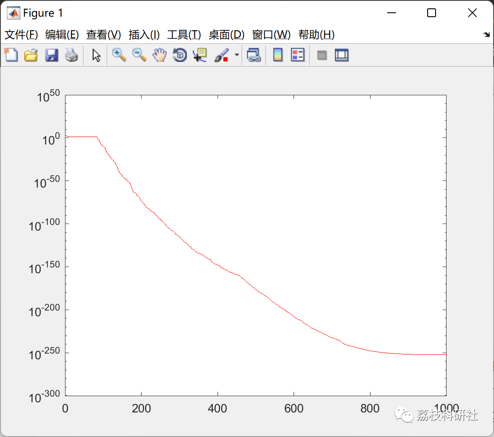

# Archimedean Optimization Algorithm (Matlab Code Implementation)

💥💥💥💞💞💞💞 Welcome to this blog❤️❤️❤️💥💥💥
🏆 Bloggers' Advantage: 🌞🌞🌞 The content of the blog strives to be rigorous in thought and clear in logic, for the convenience of readers.
⛳️ Mantra: The journey of a hundred miles is half done in the last ninety.
Litchi Research Society
Code Collection: Power System, Intelligent Algorithms and Applications, Neural Network Prediction, Path Planning, Optimized Scheduling, Workshop Scheduling, Image Processing, Signal Processing...
🎁Column Directory Link:
🌈🌈🌈🌟🌟🌟Electrical Code Intelligent Algorithm and Its Application Path Planning Neural Network Predictive Optimization Scheduling Image Processing Workshop Scheduling Signal Processing Romantic Her My Philosophical Thoughts Math Modeling Complete Code Matters
💥1 Overview
The difficulty and complexity of real-world numerical optimization problems have increased exponentially, necessitating efficient optimization methods. To date, various metaheuristics have been introduced, but only a few have gained recognition in the research community. This paper introduces a new metaheuristic algorithm, Archimedes Optimization Algorithm (AOA), to address optimization problems. The design inspiration for AOA comes from an interesting physical principle: Archimedes' principle. It mimics the principle of buoyancy applied upwards on objects partially or completely submerged in fluids, proportional to the weight of the displaced fluid. To evaluate its performance, the proposed AOA algorithm was tested on the CEC'17 test suite and four engineering design problems. The solutions obtained using AOA outperformed well-known state-of-the-art and recently introduced metaheuristic algorithms, such as Genetic Algorithm (GA), Particle Swarm Optimization (PSO), Differential Evolution Variants L-SHADE and LSHADE-EpSin, Whale Optimization Algorithm (WOA), Sine Cosine Algorithm (SCA), Harris Hawk Optimization (HHO) and Balanced Optimizer (EO). Experimental results indicate that AOA is a high-performance optimization tool with fast convergence speed and a balance between exploration and exploitation, effectively solving complex problems.
📚2 Running Results
🎉3 References
[1] Hashim, Fatma A., Kashif Hussain, Essam H. Houssein, Mai S. Mabrouk, and Walid Al-Atabany. "Archimedes optimization algorithm: a new metaheuristic algorithm for solving optimization problems." Applied Intelligence (2020): 1-21.  
🌈4 Matlab code implementation  
Click the left bottom corner of this article to read more.

## Images

<!-- PAYMENT_BLOCK -->

## Get this dataset

- Payment link (Stripe): [Buy now](https://buy.stripe.com/3cs8yP7sY87d0vu9AB)
- Payment QR code: 

<!-- /PAYMENT_BLOCK -->
